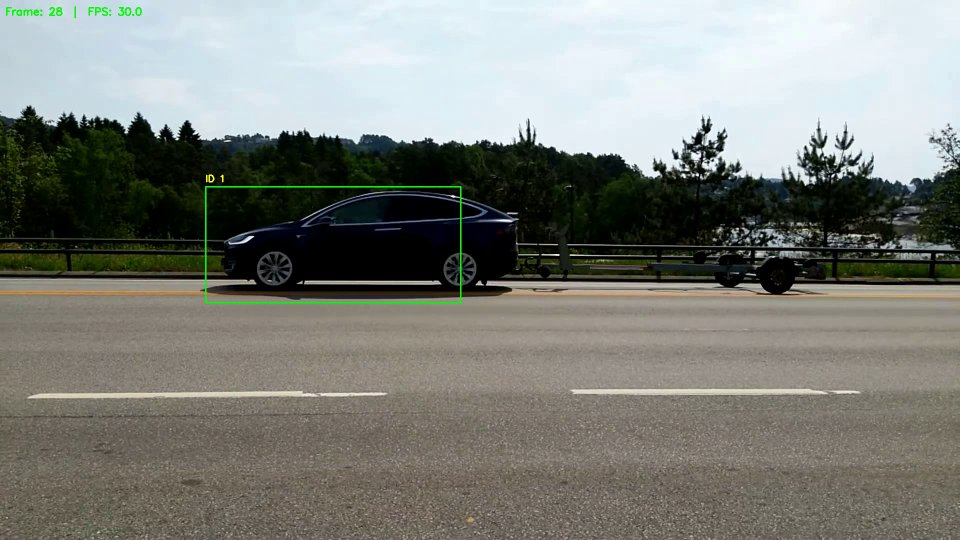
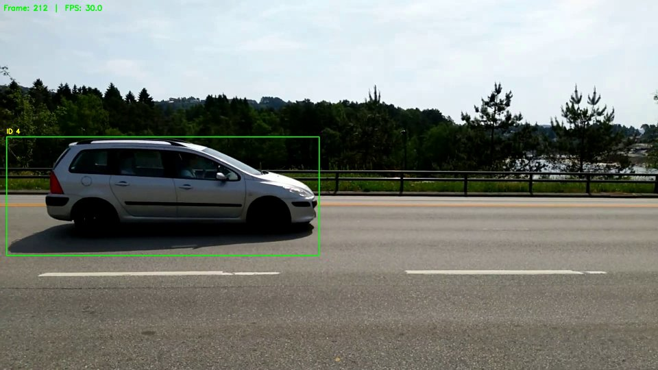
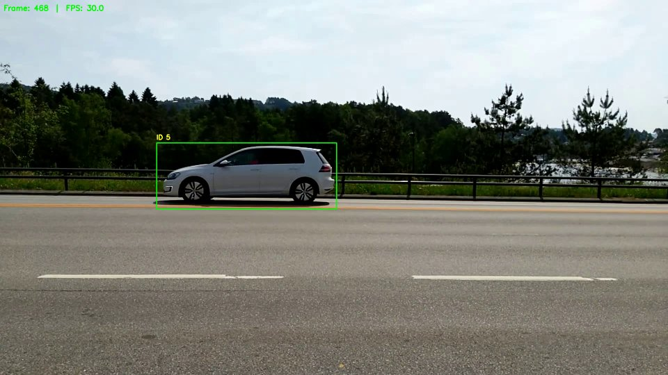

<div align="center">

# Vehicle Tracking (OpenCV)

**Detect, track and time every car in a traffic video, with classic computer vision only.**

Background subtraction, morphology and a centroid tracker give each car a stable ID, find the moment it is closest to the camera, and export an annotated video plus a JSON report. No deep learning, no GPU, no model to download: a single Python file and OpenCV.

[Demo](#demo) · [How it works](#how-it-works) · [Tech stack](#tech-stack) · [Getting started](#getting-started) · [Documentation](DOCUMENTATION.md)


[](LICENSE)

</div>

## Demo

<p align="center">
  
</p>

<p align="center">
  
  
  
</p>

On the sample video (`cars.mp4`, 1920×1080, 30 fps, 607 frames), the script finds **5 cars, 5 IDs, no false positive and no ID switch**:

| ID | Closest frame | Time | Bounding box (x, y, w, h) |
| --: | --: | --: | --- |
| 1 | 28 | 0.93 s | (411, 373, 510, 232) |
| 2 | 131 | 4.37 s | (32, 351, 546, 185) |
| 3 | 176 | 5.87 s | (63, 396, 398, 131) |
| 4 | 212 | 7.07 s | (19, 399, 912, 346) |
| 5 | 468 | 15.60 s | (450, 411, 517, 191) |

The matching JSON output is in [`docs/sample-results.json`](docs/sample-results.json).

## Features

- **Motion detection** with OpenCV's MOG2 background subtractor, which learns the empty road online, with no training data.
- **Shadow removal**: MOG2 marks shadows in gray, and a threshold drops them before they turn into false detections.
- **Mask cleanup**: a morphological opening removes noise, then dilation and erosion stitch the fragments of one car back into a single blob.
- **Box filtering and merging**: contours are filtered by area, size and aspect ratio, then nearby boxes are merged so one car gives one box.
- **Stable IDs**: nearest-centroid tracking, with a 3-hit confirmation to ignore flicker and an 8-frame grace period when a car is briefly lost.
- **Closest moment per car**: the frame where each car's bounding box is largest, so where it is nearest to the camera.
- **Outputs**: an annotated video (`output.mp4`), a JSON report (`results.json`) and a summary table in the terminal.
- **Live preview**: one window with the annotated video and one with the cleaned foreground mask, to see what the detector sees.

## How it works

Each frame goes through a linear pipeline:

```text
Frame ─► Gaussian blur ─► MOG2 subtraction ─► Threshold (drop shadows)
      ─► Open / Dilate / Erode ─► Contours + filters ─► Merge nearby boxes
      ─► Centroid tracking (IDs) ─► Closest moment ─► Video + JSON export
```

| Step | Technique | Why |
| --- | --- | --- |
| Denoise | `GaussianBlur` 11×11 | Smooths camera noise before subtraction |
| Detect motion | MOG2 (`history=700`, `varThreshold=120`) | Robust built-in subtractor with shadow detection |
| Clean the mask | Threshold at 200, then open / dilate / erode | Removes shadows and specks, joins car fragments |
| Keep cars only | Area ≥ 6000 px², `w ≥ 40`, `h ≥ 130`, aspect 0.3 to 4 | Rejects small or oddly shaped blobs |
| One car, one box | Iterative merge of boxes closer than 100 px | A car can be split into several contours |
| Track | Nearest centroid within 350 px | Simple, fast, easy to explain |
| Closest moment | Largest bounding-box area per ID | Things look bigger when they are closer |

All tuning values are constants at the top of [`app.py`](app.py). The full write-up (design choices, accuracy measurement, strengths, weaknesses and next steps) is in [`DOCUMENTATION.md`](DOCUMENTATION.md).

## Tech stack

| Area | Choice |
| --- | --- |
| Language | Python 3 (tested with Python 3.14) |
| Computer vision | OpenCV 4 (`opencv-python`, tested with 4.13) |
| Standard library | `math`, `json`, `sys` |
| Video codec | MPEG-4 (`mp4v`) through `cv2.VideoWriter` |

## Getting started

Requires Python 3.10 or newer and a desktop session (the script opens preview windows).

```bash
git clone https://github.com/Nathan-Part/vehicle-tracking-opencv.git
cd vehicle-tracking-opencv
python -m venv .venv
```

Activate the virtual environment:

```bash
# Windows (PowerShell)
.venv\Scripts\Activate.ps1

# macOS / Linux
source .venv/bin/activate
```

Install OpenCV and run:

```bash
pip install -r requirements.txt
python app.py
```

Two windows open, **Video** (annotated) and **Mask** (foreground mask). Press **`q`** to stop early. At the end, the terminal prints the closest moment of each car.

> [!IMPORTANT]
> The input and output paths are written as absolute Windows paths at the top of `app.py` (`VIDEO_PATH`, `out_path`, `json_path`, lines 7, 52 and 236). If you clone the project anywhere other than `C:\Users\natou\Desktop\ITC-2`, change these three lines first, for example to `"cars.mp4"`, `"output.mp4"` and `"results.json"`.

### Use your own video

Point `VIDEO_PATH` to another file. The camera must be **fixed**. The size filters are in pixels and were tuned on a 1080p video, so a video with another resolution or framing will probably need new values for `MIN_CONTOUR_AREA`, the `w` / `h` filters, `MERGE_GAP` and `MAX_DISTANCE`.

## Output

| File | Content |
| --- | --- |
| `output.mp4` | The input video with boxes, IDs and a frame counter |
| `results.json` | One object per car: `id`, `closest_frame`, `closest_time_sec`, `bbox` `[x, y, w, h]` and `area` |

```json
{
  "id": 4,
  "closest_frame": 212,
  "closest_time_sec": 7.07,
  "bbox": [19, 399, 912, 346],
  "area": 315552
}
```

Both files are regenerated on every run, so they are not versioned.

## Limitations

- **Fixed camera only**: any camera movement is seen as motion everywhere.
- **Stopped cars disappear**: MOG2 absorbs a stationary car into the background after a while.
- **Tuned for one scene**: pixel thresholds depend on resolution, distance and angle.
- **Close cars can merge**: the 100 px merge gap can join two cars driving close together into one box.
- **Greedy tracking**: no motion prediction and no re-identification, so a car lost for more than 8 frames gets a new ID.

## Project structure

```text
.
├── app.py                 # The whole pipeline: detection, tracking, export
├── cars.mp4               # Sample input video
├── DOCUMENTATION.md       # Technical write-up and critical analysis
├── requirements.txt       # opencv-python
├── docs/
│   ├── demo.gif           # Animated preview used in this README
│   ├── sample-results.json
│   └── screenshots/       # Closest moments of cars 1, 4 and 5
└── LICENSE
```

## Author

Created by Nathan Partouche.

## License

[MIT](LICENSE)
