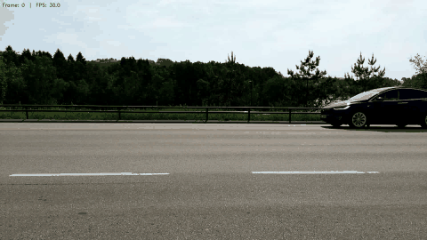
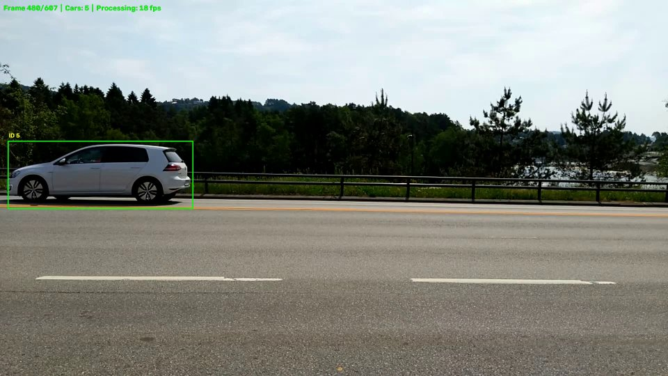

<div align="center">

# Vehicle Tracking (OpenCV)

**Detect, track and time every car in a traffic video, with classic computer vision only.**

Background subtraction, morphology and a centroid tracker give each car a stable ID, find the moment it is closest to the camera, and export an annotated video plus a JSON report. No deep learning, no GPU, no model to download: a single Python file and OpenCV.

[Demo](#demo) · [How it works](#how-it-works) · [Tech stack](#tech-stack) · [Getting started](#getting-started) · [Documentation](DOCUMENTATION.md)


[](LICENSE)

</div>

## Demo

<p align="center">
  
</p>

<p align="center">
  
  
  
</p>

On the sample video (`cars.mp4`, 1920×1080, 30 fps, 607 frames), the script finds **5 vehicles, 5 IDs, no false positive and no ID switch**:

| ID | Seen | Direction | Closest moment | Bounding box (x, y, w, h) |
| --: | --- | --- | --: | --- |
| 1 | 0.2 s → 1.7 s | ← left | 0.97 s | (370, 373, 400, 232) |
| 2 | 3.2 s → 4.8 s | ← left | 4.27 s | (171, 355, 534, 224) |
| 3 | 5.9 s → 6.0 s | ← left | 5.87 s | (76, 396, 385, 133) |
| 4 | 6.6 s → 8.0 s | → right | 7.07 s | (19, 398, 912, 347) |
| 5 | 14.6 s → 16.4 s | ← left | 16.00 s | (23, 405, 531, 194) |

The matching JSON output is in [`docs/sample-results.json`](docs/sample-results.json) (OpenCV 5.1; other OpenCV versions can shift a frame or two).

### Robustness

The same video, altered to leave the tuning conditions. Expected: 5 cars.

| Variant | 720p | 480p | 4K | Light flashes | Camera jolt |
| --- | :-: | :-: | :-: | :-: | :-: |
| Cars found | 5 | 5 | 4 / 4 ¹ | 5 | 5 |

¹ First 260 frames only, which contain 4 cars.

## Features

- **Motion detection** with OpenCV's MOG2 background subtractor, which learns the empty road online, with no training data.
- **Shadow removal**: MOG2 marks shadows in gray, and a threshold drops them before they turn into false detections.
- **Flash and jolt guard**: when more than half of the frame changes at once (lighting, camera shake), the frame is skipped instead of producing fake cars.
- **Any resolution**: detection runs on a copy resized to 1080p, so the tuned values work the same from 480p to 4K, and boxes are drawn at the real size.
- **Mask cleanup**: a morphological opening removes noise, then dilation and erosion stitch the fragments of one car back into a single blob.
- **Box filtering and merging**: contours are filtered by area, size and aspect ratio, then nearby boxes are merged so one car gives one box.
- **Stable IDs**: global nearest-first matching (independent of detection order), motion prediction for fast cars, a 3-hit confirmation against flicker, and an 8-frame grace period. IDs are numbered 1, 2, 3… with no gaps.
- **Per-car report**: closest moment (largest box), first and last time seen, and direction of travel.
- **Outputs**: an annotated video, a JSON report and a summary table in the terminal.
- **Live preview** at the video's real speed, in two windows: the annotated video and the cleaned mask. `q`, `Esc` or closing the window stops it, and `Ctrl+C` still saves what was processed.
- **Command line**: choose the input and outputs, or run headless at full speed.

## How it works

Each frame goes through a linear pipeline:

```text
Frame ─► Resize to 1080p ─► Gaussian blur ─► MOG2 ─► Threshold (drop shadows)
      ─► Global change? (skip) ─► Open / Dilate / Erode ─► Contours + filters
      ─► Merge nearby boxes ─► Centroid tracking (IDs) ─► Closest moment ─► Video + JSON
```

| Step | Technique | Why |
| --- | --- | --- |
| Normalize | Resize so `min(w, h) = 1080` | All pixel thresholds stay valid at any resolution |
| Denoise | `GaussianBlur` 11×11 | Smooths camera noise before subtraction |
| Detect motion | MOG2 (`history=700`, `varThreshold=120`) | Robust built-in subtractor with shadow detection |
| Ignore global changes | Skip if > 50 % of the frame is foreground | A flash or a jolt is not a car |
| Clean the mask | Threshold at 200, then open / dilate / erode | Removes shadows and specks, joins car fragments |
| Keep cars only | Area ≥ 6000 px², `w ≥ 40`, `h ≥ 130`, aspect 0.3 to 4 | Rejects small or oddly shaped blobs |
| One car, one box | Iterative merge of boxes closer than 100 px | A car can be split into several contours |
| Track | Closest pairs first, to the predicted or last position, within 350 px | Order-independent, follows fast cars |
| Closest moment | Largest bounding-box area per ID | Things look bigger when they are closer |

All tuning values are constants at the top of [`app.py`](app.py). The full write-up (design choices, accuracy, robustness tests, strengths, weaknesses and next steps) is in [`DOCUMENTATION.md`](DOCUMENTATION.md).

## Tech stack

| Area | Choice |
| --- | --- |
| Language | Python 3.10+ (tested with Python 3.14) |
| Computer vision | OpenCV (`opencv-python`, tested with 4.13 and 5.1) |
| Standard library | `argparse`, `dataclasses`, `pathlib`, `json`, `math`, `time` |
| Tests | `unittest` (standard library), 19 tests including end-to-end runs on generated videos |
| Video codec | MPEG-4 (`mp4v`) through `cv2.VideoWriter` |

## Getting started

Requires Python 3.10 or newer.

```bash
git clone https://github.com/Nathan-Part/vehicle-tracking-opencv.git
cd vehicle-tracking-opencv
python -m venv .venv
```

Activate the virtual environment:

```bash
# Windows (PowerShell)
.venv\Scripts\Activate.ps1

# macOS / Linux
source .venv/bin/activate
```

Install OpenCV and run:

```bash
pip install -r requirements.txt
python app.py
```

Two windows open, **Video** (annotated) and **Mask** (foreground mask). Press **`q`** or **`Esc`** to stop early. At the end, the terminal prints a summary of every car, and `output.mp4` and `results.json` are written next to `app.py`.

### Command-line options

| Option | Default | Description |
| --- | --- | --- |
| `-i`, `--input` | `cars.mp4` | Video to analyse |
| `-o`, `--output` | `output.mp4` | Annotated video |
| `-j`, `--json` | `results.json` | JSON report |
| `--no-video` | off | Don't write the annotated video |
| `--no-display` | off | No preview windows, process as fast as possible (servers, CI) |

```bash
python app.py --input my_video.mp4 --output out/annotated.mp4 --json out/report.json
python app.py --no-display --no-video     # just the report, as fast as possible
```

Output folders are created automatically, and the script refuses to write the output video over the input.

### Run the tests

```bash
python -m unittest -v
```

### Use your own video

The camera must be **fixed**. The resolution doesn't matter, but the size filters assume cars fill roughly the same share of the frame as in the sample video. For a camera much farther away or at another angle, adjust `MIN_CONTOUR_AREA`, `MIN_BOX_W` / `MIN_BOX_H`, `MERGE_GAP` and `MAX_DISTANCE` at the top of `app.py`.

## Output

| File | Content |
| --- | --- |
| `output.mp4` | The input video with boxes, IDs, the car count and the processing speed |
| `results.json` | One object per car (see below) |

```json
{
  "id": 4,
  "closest_frame": 212,
  "closest_time_sec": 7.07,
  "bbox": [19, 398, 912, 347],
  "area": 316464,
  "first_seen_sec": 6.63,
  "last_seen_sec": 8.0,
  "direction": "right"
}
```

Both files are regenerated on every run, so they are not versioned.

## Limitations

- **Fixed camera only**: short jolts are skipped, but a moving camera sees motion everywhere.
- **Stopped cars disappear**: MOG2 absorbs a stationary car into the background after a while.
- **Low contrast**: a dark car in front of dark trees is only partly detected, so its box can be too small.
- **Close cars can merge**: the 100 px merge gap can join two cars driving close together into one box.
- **No re-identification**: a car lost for more than 8 frames gets a new ID.

## Project structure

```text
.
├── app.py                 # The whole pipeline: detection, tracking, report, CLI
├── cars.mp4               # Sample input video
├── DOCUMENTATION.md       # Technical write-up and critical analysis
├── requirements.txt       # opencv-python
├── tests/
│   └── test_app.py        # Unit and end-to-end tests
├── docs/
│   ├── demo.gif           # Animated preview used in this README
│   ├── sample-results.json
│   └── screenshots/       # Closest moments of cars 2, 4 and 5
└── LICENSE
```

## Author

Created by Nathan Partouche.

## License

[MIT](LICENSE)
